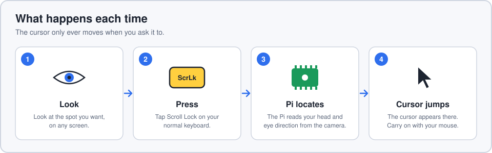
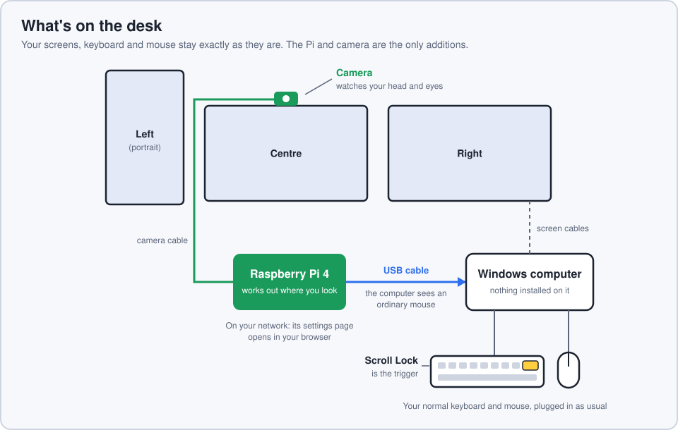
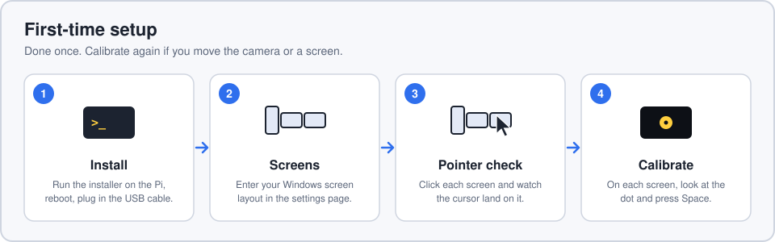
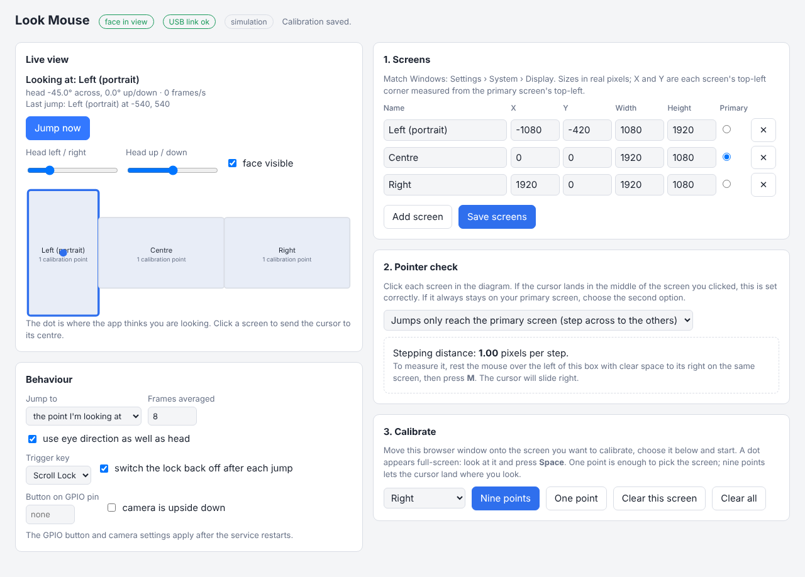

# look-mouse

Look at a screen, press a key, and the mouse cursor jumps to where you are looking.
Your normal mouse then carries on as usual.



## What does what



| Part | Its job |
|---|---|
| **Camera** | Sits on top of the centre screen and watches your head and eyes. |
| **Raspberry Pi 4** | Reads the camera, works out which screen you are looking at and where on it, and tells the computer where to put the cursor. |
| **USB cable** (Pi to computer) | Carries the "put the cursor here" message. To Windows the Pi looks like an ordinary mouse, so nothing is installed on the computer. |
| **Scroll Lock** on your normal keyboard | The trigger. Windows tells every keyboard when a lock key changes, and the Pi listens for that. The Pi switches the lock straight back off. |
| **Your normal mouse and keyboard** | Unchanged. They stay plugged into the computer and work as before. |
| **Settings page** | A web page served by the Pi, opened in a browser on the computer. Used for setup, calibration and tuning. |

## What you need

- Raspberry Pi 4 with Raspberry Pi OS (64-bit), connected to your network
- A camera: Raspberry Pi Camera Module 3 Wide, or a wide-angle USB webcam
- A USB-C **data** cable from the Pi's USB-C port to the Windows computer (charge-only cables won't work)

## First-time setup



### 1. Install

Mount the camera on top of the centre screen, facing you, and connect it to the Pi.
On the Pi:

```
git clone https://github.com/Walkergray79/look-mouse
cd look-mouse
bash install.sh
sudo reboot
```

Cable the Pi's USB-C port to the Windows computer. On the Windows computer, open
`http://<pi-name>.local:8080` in a browser. The **face in view** and **USB link ok** badges
at the top should both be green.

The USB-C port is also the Pi 4's power input, so the Pi is powered by the computer's USB
port. If the Pi shows low-voltage warnings or restarts, use a USB-C power/data splitter or
power it through the GPIO header.

### 2. Screens

In Windows, open Settings › System › Display. Enter each screen's size in pixels, and its
position measured from the top-left corner of the primary screen. Tick which one is
primary, then **Save screens**.

### 3. Pointer check

Click each screen in the diagram on the settings page. The cursor should land in the
middle of the screen you clicked.

If it only ever lands on the primary screen, change the dropdown to "Jumps only reach the
primary screen", then rest the mouse over the dashed box and press **M** to measure the
stepping distance. This mode is only repeatable with Windows' "Enhance pointer precision"
switched off.

### 4. Calibrate

For each screen in turn: drag the browser onto that screen, choose it in the dropdown,
click **Nine points**, then look at each dot and press **Space**. Sit as you normally
would while you do it.

**One point** per screen is a quicker start: it is enough to jump between screens, landing
in the centre of each.

## Everyday use

Look at where you want the cursor and tap **Scroll Lock**. The cursor appears there and
you carry on with your normal mouse.



Things to tune on the settings page:

- **Jump to**: the point you are looking at, or always the centre of the screen.
- **Use eye direction**: turn off to follow your head only, which is steadier but coarser.
- **Frames averaged**: higher is steadier, lower reacts faster.
- **Trigger key**: Scroll Lock, Caps Lock or Num Lock, or a push button wired to the Pi.

## If something isn't working

| What you see | What to try |
|---|---|
| "no face in view" or "camera problem" | Check the camera cable and that the preview shows your face. The message under **Live view** gives the detail. |
| "USB link down" | The cable must be in the Pi's USB-C port (not the four big USB ports) and must be a data cable. |
| Scroll Lock does nothing | Press **Jump now** on the settings page. If that works, the trigger is the problem: try another trigger key. If it says "Not calibrated yet", calibrate. |
| Cursor goes to the wrong screen | Recalibrate that screen. Calibrate again whenever the camera or a screen has moved. |
| Cursor only ever lands on the primary screen | Redo the pointer check and switch the dropdown. |
| Cursor lands near but not on the spot | Use nine points rather than one, raise **Frames averaged**, or try with eye direction off. |

## Try it without a Pi

```
pip install numpy
python3 -m look_mouse --simulate
```

Open `http://localhost:8080`. Sliders stand in for your head and nothing is sent over USB.
The page is read from disk on every refresh, so interface edits show immediately.

## Layout of the code

| File | What it does |
|---|---|
| `look_mouse/tracker.py` | Camera and face tracking (MediaPipe); produces head and eye measurements |
| `look_mouse/gaze.py` | Calibration maths: measurements to "which screen, where on it" |
| `look_mouse/hid.py` | USB output (jump, step, key tap) and the lock-key listener |
| `look_mouse/app.py` | Ties it together: trigger, estimate, jump |
| `look_mouse/server.py`, `look_mouse/web/index.html` | The web interface and its API |
| `look_mouse/config.py` | Settings and calibration, saved in `~/.config/look-mouse/config.json` |
| `scripts/setup_gadget.sh` | Makes the Pi appear as USB devices (run at boot by the installer) |

Tests: `python3 -m unittest discover -s tests`

## What has and hasn't been tested

Tested on a desktop Linux machine: the calibration maths, jump logic, trigger logic, web
interface (in simulation), and the face tracker against a sample photo (MediaPipe 1.2.3).

Not yet run on a Pi: the installer, the USB device setup, the Pi camera capture, and how
Windows places the pointer across three screens. The pointer check in the web page exists
to settle that last one.

## Notes

- The web page has no password. Anyone on your network can open it and see the camera
  preview.
- Camera frames are processed on the Pi and are not stored or sent anywhere else.
