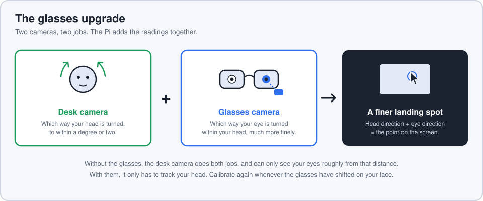

# Glasses upgrade: a camera pointed at your eye

The desk camera sees your eyes from arm's length, so it can only judge eye direction
roughly. A small camera on your glasses, a few centimetres from one eye, sees the pupil
large and clear. With it switched on:

- the **desk camera** still tracks which way your head is turned;
- the **glasses camera** tracks where the pupil sits, which is which way the eye is turned
  within the head;
- the Pi combines the two when you press the trigger.

Everything else (trigger, USB link, calibration, settings page) works as before. Switch
the glasses camera off and the app goes back to using the desk camera alone.

## What to expect

Eye direction becomes the precise part and head direction becomes the limit: the desk
camera's head reading wobbles by a degree or two, which the app steadies by averaging
recent frames. Expect a clear improvement over the desk camera alone, most of all on the
portrait screen where you scan with your eyes more than your head. It will not be
pixel-accurate; the mouse still does the last small move.

## Hardware

Any camera the Pi can open works. Two practical routes:

| Route | What it is | In the settings page |
|---|---|---|
| **Wired** | A small USB camera module on a thin cable to one of the Pi's USB ports | Camera number, usually `1` (the desk camera, if USB, is `0`) |
| **Wireless** | A small Wi-Fi camera board that streams video (MJPEG), such as the ESP32-based trackers built by the open-source EyeTrackVR community | Its stream address, e.g. `http://192.168.1.50:81/stream` |

Mounting:

- Fix the camera to the glasses frame, below or to the side of one eye, 2 to 4 cm away,
  pointing at the eye. It must not move relative to the glasses.
- The pupil needs to be the darkest thing in the picture. An infrared camera with a small
  infrared light gives the cleanest picture in any room lighting; an ordinary camera works
  in good, even light.
- If you add infrared lights, use ones intended for eye tracking and follow their safety
  guidance. Infrared is invisible, so your eye does not react to a light that is too strong.

## Setting it up

1. Open the settings page and find **Glasses camera (optional)**.
2. Enter the camera number or stream address and tick **use the glasses camera**.
3. Tick **Diagnostics** at the top of the page to see the glasses camera's picture. A
   green outline should hug the pupil as you look around. If it
   doesn't, re-aim the camera, or change **Pupil darkness**: raise it if no outline
   appears, lower it if the outline spills beyond the pupil.
4. **Clear all** calibration and calibrate each screen again with nine points. Calibration
   made without the glasses can't be reused with them, and the app will tell you so.

## Living with it

- **Calibrate again when the glasses shift.** The calibration assumes the camera sits in
  the same place relative to your eye. Pushing the glasses up your nose changes that.
- **Blinks are ignored.** If the pupil isn't visible at the moment you press the trigger,
  nothing happens; press again.
- **One eye is enough.** Both eyes point at the same spot.

## What has and hasn't been tested

Tested: pupil detection on drawn eye pictures (including eyelashes, a light's reflection
and dark picture corners), the camera loop on a generated video, and the combination with
head direction in simulation.

Not yet tested: a real eye through a real glasses camera. Expect to tune the camera
position and **Pupil darkness**, and the detection itself may need refining once there are
real pictures to work from.

## Where the code is

- `look_mouse/eye.py`: opens the glasses camera and finds the pupil.
- `look_mouse/app.py`, `features()`: swaps the desk camera's eye reading for the glasses
  camera's when it is switched on.
